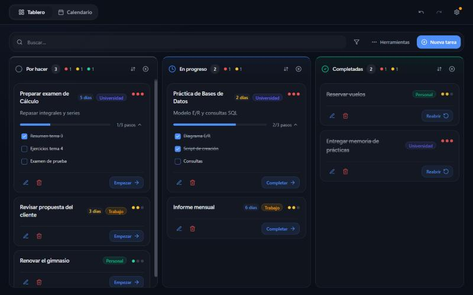
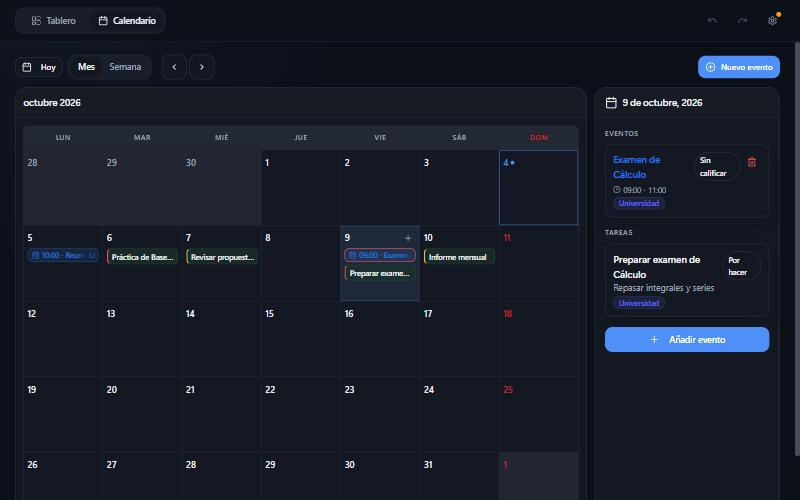
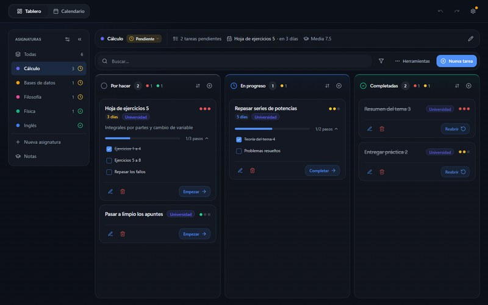
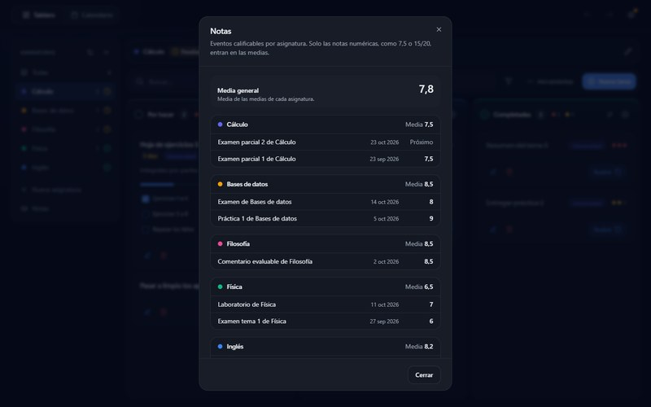

# TaskMaster

[](https://github.com/Kakauet/tasks/actions/workflows/ci.yml) [](LICENSE)

Un tablero de tareas y un calendario en la misma app. Me la hice para llevar los estudios: qué tengo pendiente, cuándo son las entregas y los exámenes, y cómo voy en cada asignatura.

Funciona en el navegador, sin cuenta y sin instalar nada. Si quieres, se sincroniza entre dispositivos.

<table>
  <tr>
    <td width="50%"></td>
    <td width="50%"></td>
  </tr>
  <tr>
    <td align="center">Tablero</td>
    <td align="center">Calendario</td>
  </tr>
</table>

## Qué se puede hacer

### Tablero

Tres columnas: por hacer, en progreso y completadas. Las tareas se arrastran de una a otra (también en el móvil), se ordenan por prioridad, fecha o nombre y se pueden dividir en pasos. La prioridad se cambia con un toque sobre los puntos de la tarjeta, sin abrirla.

Cada tarea puede llevar fecha límite, etiquetas y descripción. Hay búsqueda, filtro por prioridad y acciones en bloque para mover o borrar varias a la vez.

### Calendario

Vista de mes y de semana. Los eventos pueden durar varios días o repetirse, y se cambian de fecha arrastrándolos. Los exámenes y demás eventos evaluables guardan también la nota.

### Y además

- Temporizador de foco para dedicarle un rato a una tarea y llevar la cuenta del tiempo.
- Deshacer y rehacer cualquier cambio.
- Atajos de teclado: `N` nueva tarea, `E` nuevo evento, `/` buscar y `?` para ver el resto.
- Modo claro y oscuro, con el color de acento a tu gusto.
- Se puede añadir a la pantalla de inicio del móvil y usarla como una app más.

## Asignaturas

Novedad de la 3.3. Son opcionales: se activan en Configuración y, si no las usas, no aparecen por ningún lado.

Cada tarea o evento puede ir a una asignatura, y desde la barra lateral (o el selector de arriba en el móvil) se filtra todo para ver solo lo de una. Arriba aparece un resumen: si vas al día, cuántas tareas te quedan, lo próximo que tienes y tu media.

Casi nunca hace falta asignarlas a mano. Si el título lleva el nombre de la asignatura o uno de sus apodos («Filo» para Filosofía), va a esa asignatura, y si lleva «examen», cuenta como examen. Al crear una asignatura también recoge lo que ya tenías apuntado con ese nombre.

Por defecto vas al día cuando no te quedan tareas de prioridad media o alta. Puedes cambiar el criterio o marcarlo tú con un toque en el estado.

<table>
  <tr>
    <td width="50%"></td>
    <td width="50%"></td>
  </tr>
  <tr>
    <td align="center">Tablero filtrado por asignatura</td>
    <td align="center">Notas y medias</td>
  </tr>
</table>

## Tus datos

Todo se guarda en tu navegador (IndexedDB). Para tener una copia aparte puedes exportar los datos a un archivo JSON y volver a importarlos cuando quieras, combinándolos con lo que ya tienes o sustituyéndolo. Antes de importar se guarda una copia de recuperación por si acaso.

La sincronización entre dispositivos es opcional y va con Supabase. Si dos dispositivos cambian cosas a la vez, se juntan los cambios de los dos en lugar de quedarse solo con el último.

Las actualizaciones no tocan lo que ya tienes guardado: los datos y las copias de versiones anteriores se siguen cargando igual.

Más detalles en [Datos y actividad](docs/DATA_AND_ACTIVITY.md).

## Probarla en tu ordenador

Necesitas Node.js 22 (la versión está en `.nvmrc`).

```bash
git clone https://github.com/Kakauet/tasks.git
cd tasks
npm ci
npm run dev
```

Se abre en [localhost:3000](http://localhost:3000) y funciona sin configurar nada más.

Para la sincronización, copia `.env.example` a `.env.local`, pon los datos de tu proyecto de Supabase y sigue la [guía de configuración](docs/SUPABASE_SETUP.md).

Para publicarla puedes usar Vercel o generar una versión estática con `npm run build:dist`. Está explicado en [Despliegue](docs/DEPLOY.md).

## Desarrollo

Next.js 14, React 18 y TypeScript, con Tailwind CSS y componentes de shadcn/ui.

Antes de subir cambios conviene pasar las mismas comprobaciones que ejecuta GitHub Actions:

```bash
npm run typecheck
npm run lint
npm test
npm run build
```

Las pruebas no necesitan cuentas, credenciales ni navegador.

Documentación del proyecto:

- [Desarrollo](docs/DEVELOPMENT.md): estructura del código y comandos.
- [Arquitectura](docs/ARCHITECTURE.md): estado, historial, guardado y sincronización.
- [Diseño](docs/DESIGN.md): colores, componentes y criterios de la interfaz.

Si encuentras un fallo o se te ocurre algo, abre una issue. Ayuda mucho saber los pasos para reproducirlo y qué navegador usas.

## Licencia

[MIT](LICENSE)
