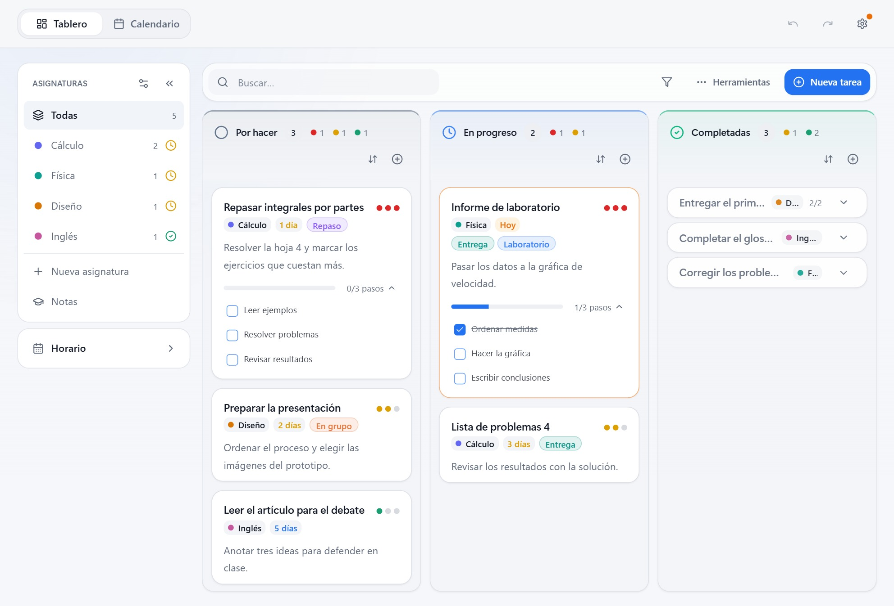
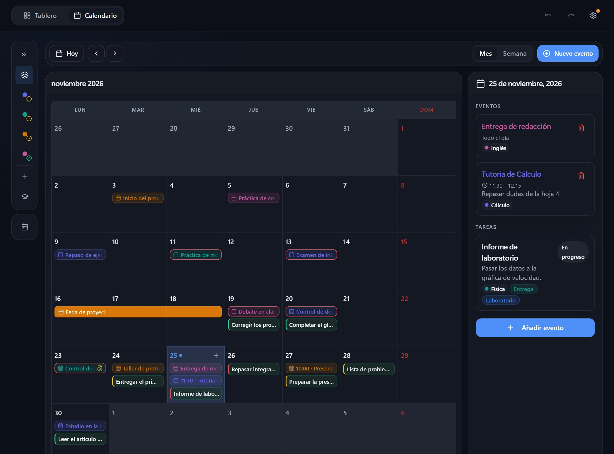
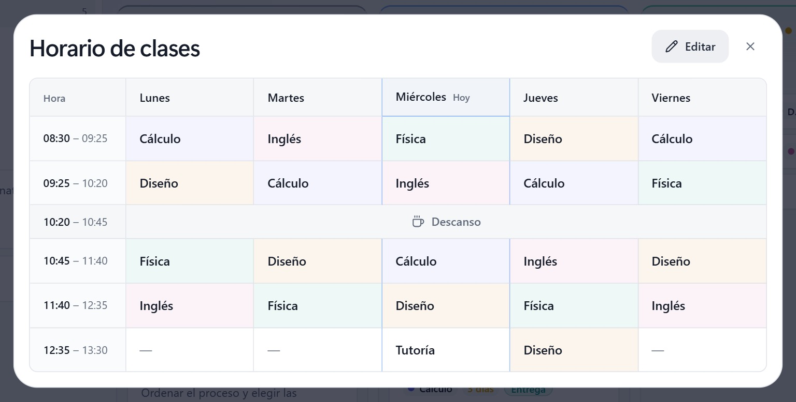
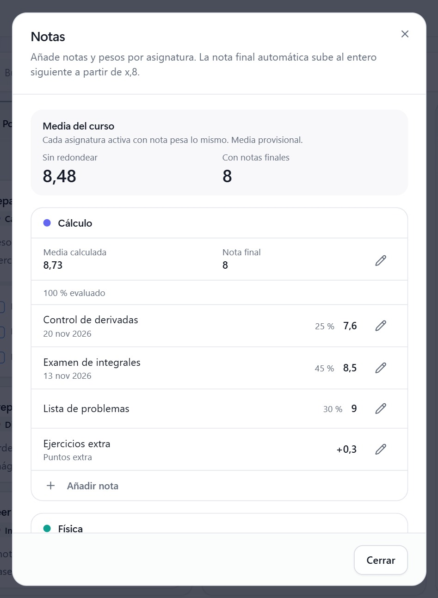
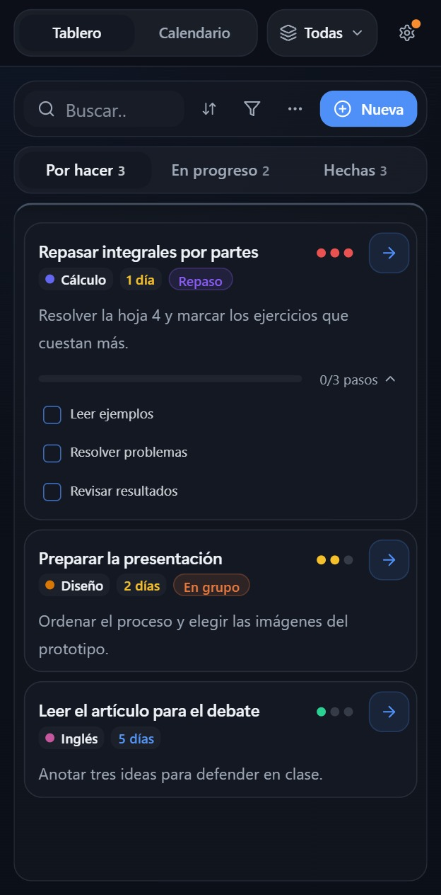
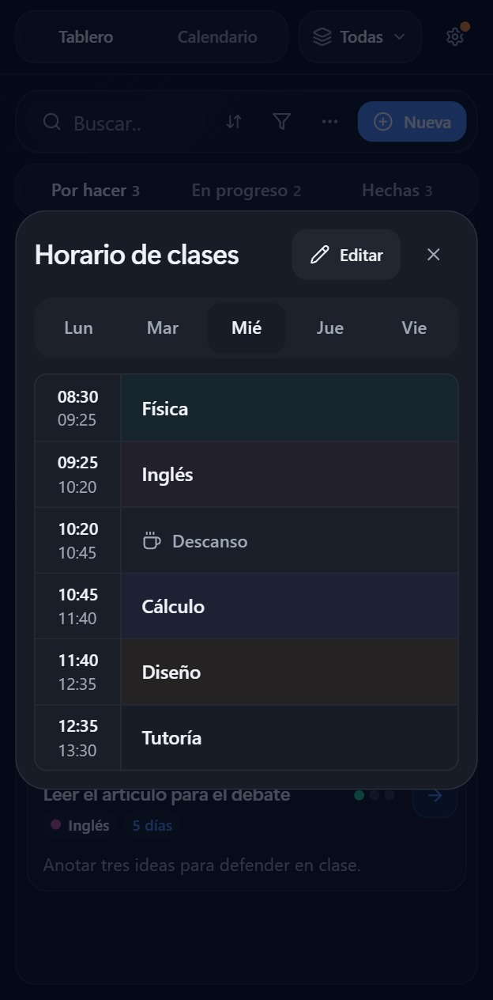

# TaskMaster

[](https://github.com/Kakauet/tasks/actions/workflows/ci.yml) [](LICENSE)

Hice TaskMaster para tener a mano las tareas, las entregas y las notas de cada asignatura. Funciona en el navegador y puedes empezar sin cuenta.

**[Abrir TaskMaster](https://tasks-3-5.netlify.app/)** · [Ver las novedades de la 3.5](https://github.com/Kakauet/tasks/releases/tag/v3.5.0)



## Tablero y calendario

**Tablero.** Arrastra las tareas entre columnas y divide las más largas en pasos. Puedes poner fechas límite y etiquetas, cambiar la prioridad desde la tarjeta y usar la búsqueda o los filtros para centrarte en lo que toca. Si te equivocas, puedes deshacer el cambio.

**Calendario.** Mira las tareas con fecha y los eventos por mes o por semana. Los eventos se pueden arrastrar, repetir o extender a varios días. Cuando pasa un examen y aún no has puesto la nota, el calendario lo marca como pendiente.



Para estudiar con el **Pomodoro**, abre el temporizador con `P` o desde **Herramientas**. Puedes usar ciclos de 25/5 o 50/10, y el tiempo de concentración se suma a la tarea en la que estabas trabajando. Pulsa `?` para ver el resto de los atajos.

## Asignaturas, horario y notas

Activa **Asignaturas** en **Configuración** para filtrar tareas y eventos por materia. Al seleccionar una, verás qué te queda, qué viene después y cómo va tu media. Si el título menciona «Cálculo» o su apodo «Mates», la app puede hacer la asignación por ti. Puedes elegir cómo se calcula el estado «Al día» o marcarlo a mano.

### Horario de clases

Activa **Horario** en **Configuración** para consultar las clases de lunes a viernes. Puedes editar las franjas y los descansos, y abrir la vista rápida por día desde la barra lateral.



### Notas y medias

En **Notas** puedes poner pesos a los exámenes, registrar trabajos sin crear un evento y sumar puntos extra. Verás la media calculada y la nota final de cada asignatura, además de la media del curso. También puedes fijar una nota final a mano.

<p align="center">
  
</p>

## En el móvil

El tablero muestra una columna cada vez y el horario enseña las clases del día que elijas. Puedes añadir TaskMaster a la pantalla de inicio y elegir el tema claro u oscuro desde **Configuración**.

<p align="center">
  
  
</p>

## Tus datos

TaskMaster guarda los datos en tu navegador con IndexedDB. Puedes exportar una copia en JSON o JSON comprimido e importarla para combinarla con tus datos o reemplazarlos. Antes de importar, la app guarda una copia de recuperación. Las copias de versiones anteriores se siguen pudiendo abrir.

Si quieres usar los mismos datos en varios dispositivos, inicia sesión para activar la sincronización con Supabase. Cuando dos dispositivos cambian cosas a la vez, la app combina los cambios. [Datos y actividad](docs/DATA_AND_ACTIVITY.md)

## Probarlo en local

Usa Node.js 22, la versión indicada en `.nvmrc`.

```bash
git clone https://github.com/Kakauet/tasks.git
cd tasks
npm ci
npm run dev
```

Abre [localhost:3000](http://localhost:3000). Para activar la sincronización en tu instalación, copia `.env.example` a `.env.local` y sigue la [guía de Supabase](docs/SUPABASE_SETUP.md).

## Desarrollo

El proyecto usa Next.js 14, React 18 y TypeScript, con Tailwind CSS y componentes de shadcn/ui. GitHub Actions ejecuta estas comprobaciones en los pull requests y al subir cambios a `main`.

```bash
npm run typecheck
npm run lint
npm test
npm run build
```

[Guía de desarrollo](docs/DEVELOPMENT.md) · [Arquitectura](docs/ARCHITECTURE.md) · [Diseño](docs/DESIGN.md) · [Despliegue en Netlify](docs/DEPLOY.md)

Si encuentras un fallo o tienes una idea, [abre una issue](https://github.com/Kakauet/tasks/issues/new). Si algo falla, indica qué estabas haciendo y qué navegador usas.

## Licencia

[MIT](LICENSE)
